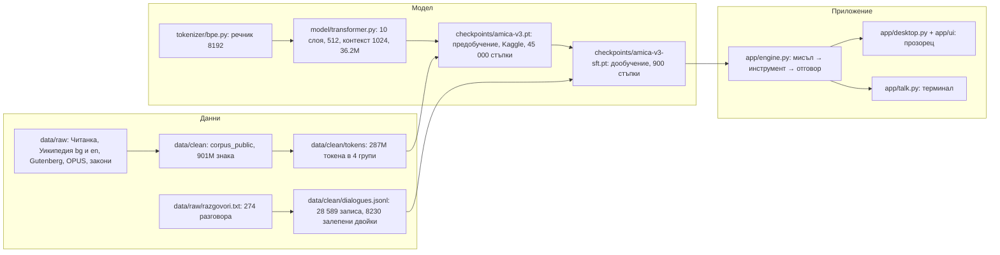
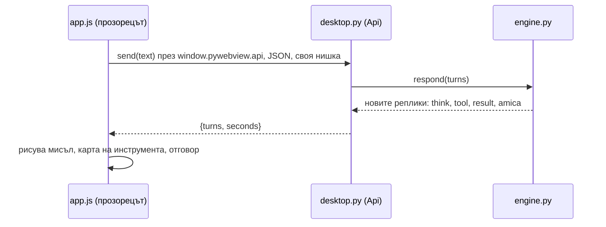

# Амика · карта на състоянието

Какво има Амика в момента, какво може и каква е следващата стъпка. Схемите са Mermaid и се
рисуват в GitHub и във VS Code (разширение Markdown Preview Mermaid Support). Обновява се в края
на всяка сесия заедно с „Текущо състояние“ в CLAUDE.md. Числата и изводите от пусканията са в
EXPERIMENTS.md, текстът за следващото обучение е в docs/TRAINING.md.

Последно обновяване: 2026-10-27.

## 1. Какво има Амика сега

| Част | Файл | Състояние |
|---|---|---|
| Токенизатор | tokenizer/bpe.py, amica_bpe.json | готов, речник 8192, 8 служебни токена, около 3.1 знака на токен |
| Корпус за предобучение | data/clean/corpus_public, data/clean/tokens/*.bin | окончателен за v3 (2026-10-26): 222 664 документа, 900.82M знака: bg_wiki 438.3M (48.7%), en 363.2M (40.3%: Simple English, English Wikipedia, Gutenberg, OPUS en), law 79.1M (8.8%), lit 20.2M (2.2%); в токени 287.0M (train: bg_wiki 136.1M, en 118.1M, law 23.0M, lit 6.2M); в Kaggle като pavel77ivanov/amica-bg, осемте .bin файла в корена на dataset-а |
| Модел v3 | model/transformer.py, checkpoints/amica-v3.pt | 36 243 456 параметъра: 10 слоя, 8 глави, ширина 512, контекст 1024, споделени вграждания, fp16 + SDPA; Kaggle 45 000 стъпки (737M токена, 20 на параметър), 5.45 часа; val bg_wiki 2.53, en 2.67, lit 3.43, law 1.95 на токен (v2: 2.92 / 2.96 / 3.77); без презаучаване, кривите още падат |
| Модел v2 | checkpoints/amica-v2.pt | 13 989 888 параметъра, контекст 512; още работи с `py app/chat.py v2` за сравнение |
| Разговори | data/raw/razgovori.txt → dialogues.jsonl | 274 разговора (46 оригинални + 228 варианта по формулировки); build_dialogues.py прави до 200 копия с шаблони и различен системен ред и от 2026-10-27 залепва с PAIR=0.3 по два свободни разговора в едно копие с две теми (val не участва): 28 589 записа, 8230 двойки, val 27 разговора (1822 записа) |
| Дообучение (SFT) | train/train_sft.py, checkpoints/amica-v3-sft.pt | 2026-10-27, 11:11: 900 стъпки от amica-v3.pt (BASE), 89 мин на процесора, replay от четирите групи, val 0.98 (стъпка 300) → 1.15; пробите: смяна на темата, clock и date с преписан резултат, формулировки с малка буква верни; слабо: първият множител в отговора на сметката |
| Двигател | app/engine.py | цикъл мисъл → извикване → резултат → отговор, до 4 кръга; инструменти clock, date, calc; temperature 0.2, top-k 10; прозорецът идва от checkpoint-а (1024) |
| Настолно приложение | app/desktop.py, app/ui/ | стъпки 1 и 2: прозорец, поздрав по часа, анимация, разговор с карти на инструментите; зарежда amica-v3-sft.pt; пряк път на работния плот с pyw.exe и икона assets/amica.ico |
| Икона | assets/amica.ico, assets/make_icon.py | вариант 1: метален пръстен, черно стъкло, златисти букви AM в четкан метал, Inter 800; .ico със 7 размера от 16 до 256 px, нарисувана с numpy + Pillow |
| Английски книги | data/import_gutenberg.py, data/raw/_gutenberg | 68 книги от Project Gutenberg (42.5M знака), обществено достояние; в v3 в групата en |
| OPUS bg-en | data/import_opus.py, data/raw/_opus | Europarl, DGT, EU Bookshop, Tatoeba: 65.6M знака български (official регистър, група law; Tatoeba в lit) и 40.6M английски (група en); двойките за превода остават в архивите за етап 5 |
| Закони | data/import_laws.py, data/raw/_laws | 113 закона и кодекси от parliament.bg (2009–2026), Конституцията и Търговският закон от Уикиизточник, свободни (ЗАПСП, чл. 4, т. 1); в v3 отделна група „law“, val 1.95 |
| Данни на Амика | Documents\Amica | memory.txt (ред „Име: ...“); останалото идва със стъпки 3 до 7 |

## 2. Какво може и какво не

Може (пробите от 2026-10-27 с amica-v3-sft.pt, EXPERIMENTS.md):
- Отговаря, вместо да продължава текста: „Коя си ти?“ → „Аз съм Амика.“, поздрави, отказ, „Човек ли си?“, приказка.
- Държи темата при смяна: „Коя си ти?“ → „Какво можеш да правиш?“ верен 3 от 3; три теми подред (здравей → кой те
  направи → чао) 3 от 3; идентичност → час 3 от 3. До 2026-10-27 повтаряше предишния си отговор.
- Формата мисъл → извикване → резултат → отговор; clock и date верни 6 от 6 с правилно преписан час и пълна дата
  (при v2 датата беше с 2 дни грешка); calc с вярно извикване и верен резултат.
- Непознати формулировки: с малка буква, без въпросителна, с друг словоред.
- В приложението: прозорец с кръглото лого и анимацията, поздрав по часа с името от memory.txt, разговор с балон,
  бледа мисъл, карта на инструмента с резултата и отговор със секундите; New chat.

Не може или е слабо:
- Преписването на двуцифрено число от въпроса в последното изречение при сметка, когато в контекста има още числа:
  „19 по 23 е 391“, „432 по 9 е 432“ (6 по 7 и 25 по 4 са верни). Резултатът от calc е верен; картата с резултата е
  източникът на истината.
- „Здравейте, ще ми помогнете ли“ получава отговор на „ти“, защото така е в данните (47, 272, 273); решението дали
  Амика да мине на „Вие“ още при първата реплика е на автора.
- Прозорецът е 1024 токена и се реже по токени: при дълъг разговор първо пада системният ред с инструментите
  (рязане по цели реплики идва със стъпка 3).
- Няма памет между чатове, чатовете не се записват, няма потвърждение за опасни действия (още няма такива
  инструменти), няма Settings и оценки.

## 3. Следваща стъпка, подредени по полза

Изчакването от 2026-10-26 приключи: v3 и дообучението върху нея са готови на 2026-10-27.

1. Приложение, стъпка 3: чатовете като JSON в Documents\Amica\chats, списъкът вляво, рязане на прозореца по цели
   реплики със запазен системен ред.
2. Данни: упражнения за преписване на числа (още сметки със събиране и изваждане, числата повторени в мисълта),
   решение за „Вие“ при първа реплика на „Вие“, десетина ръчни разговора с естествени продължения („А на английски?“,
   „Какво още?“), които залепването не дава. После същото дообучение (90 мин) и пробите.
3. Приложение, стъпки 4 до 7: Activity и потвърждение (флаг на инструмент в engine.py), Memory, Settings, оценки.
4. Второ предобучение v3 със 70 000 стъпки и W_LIT 0.04 (кривите още падаха при минималния lr; до 4 обиколки на
   корпуса, около 8.5 часа в Kaggle), или v4 с повече данни (българският е тясното място: Уикипедия е изчерпана, лостът
   са таваните на OPUS).
5. Превод EN→BG от двойките в OPUS (етап 5).

## 4. Схеми

### Един ход на Амика (агентният цикъл в engine.respond)

Моделът само пише текст. Приложението решава какво е действие (<|tool|>), изпълнява го и вписва резултата.
Инструментът е функция без преценка: вход → изход. Моделът + цикълът + инструментите заедно са агентът.
„Мисленето“ е текст, който моделът пише на себе си: всеки токен е още една сметка през десетте слоя, а написаното
е единствената памет между два токена.

### Пътят на едно съобщение в приложението

### Какво вижда моделът при всяка реплика

- Целият текущ разговор, автоматично, до 1024 токена (около 2800 знака, 2.75 знака на токен в разговор).
- Резултатите от инструментите, които сама е поискала.
- По-късно: редове от memory.txt и намерено в стари чатове, които приложението слага в <|system|>; работи само
  с примери за това в razgovori.txt.
- Бюджет: <|doc|> и системният ред 17 токена, кратка реплика 5, мисъл с извикване и резултат 28, среден
  отговор 25, седем реда памет 70, място за отговора 120.
