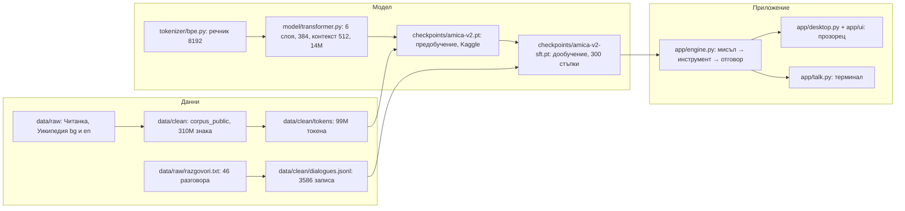
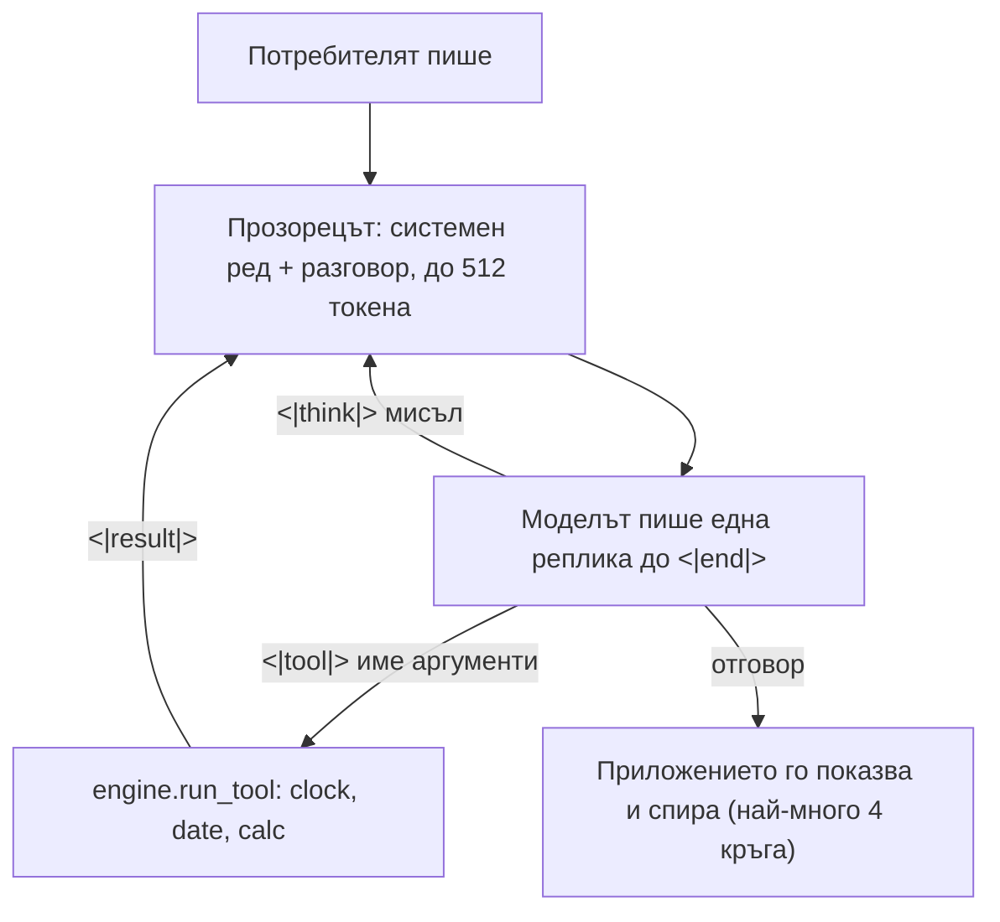
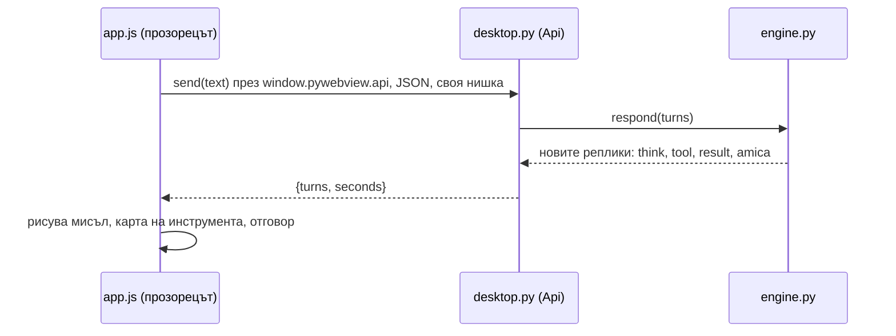

# Амика · карта на състоянието

Какво има Амика в момента, какво може и каква е следващата стъпка. Схемите са Mermaid и се
рисуват в GitHub и във VS Code (разширение Markdown Preview Mermaid Support). Обновява се в края
на всяка сесия заедно с „Текущо състояние“ в CLAUDE.md. Числата и изводите от пусканията са в
EXPERIMENTS.md, текстът за следващото обучение е в docs/TRAINING.md.

Последно обновяване: 2026-10-26, вечер.

## 1. Какво има Амика сега

| Част | Файл | Състояние |
|---|---|---|
| Токенизатор | tokenizer/bpe.py, amica_bpe.json | готов, речник 8192, 8 служебни токена, около 3.1 знака на токен |
| Корпус за предобучение | data/clean/corpus_public, data/clean/tokens/*.bin | окончателен за v3 (2026-10-26): 222 664 документа, 900.82M знака: bg_wiki 438.3M (48.7%), en 363.2M (40.3%: Simple English, English Wikipedia, Gutenberg, OPUS en), law 79.1M (8.8%), lit 20.2M (2.2%); токените в четири групи се правят с encode_corpus.py |
| Модел v2 | model/transformer.py, checkpoints/amica-v2.pt | 13 989 888 параметъра, val Уикипедия 2.92, литература 3.77, английски 2.96 на токен |
| Разговори | data/raw/razgovori.txt → dialogues.jsonl | 274 разговора (46 оригинални + 228 варианта по формулировки, 2026-10-26), по до 200 копия с шаблони и различен системен ред, 21 539 записа, val 27 разговора |
| Дообучение (SFT) | train/train_sft.py, checkpoints/amica-v2-sft.pt | 2026-10-26, 09:51: 900 стъпки върху 274 разговора, val 1.07 → 1.17 (варианти на учени ситуации); непознатите формулировки работят, преписването на числа е слабо; работещият модел е от стъпка 899 |
| Двигател | app/engine.py | цикъл мисъл → извикване → резултат → отговор, до 4 кръга; инструменти clock, date, calc |
| Настолно приложение | app/desktop.py, app/ui/ | стъпки 1 и 2: прозорец, поздрав по часа, анимация, разговор с карти на инструментите |
| Английски книги | data/import_gutenberg.py, data/raw/_gutenberg | 68 книги от Project Gutenberg (42.5M знака), обществено достояние; за v3 в групата en |
| OPUS bg-en | data/import_opus.py, data/raw/_opus | Europarl, DGT, EU Bookshop, Tatoeba: 65.6M знака български (official регистър, група law; Tatoeba в lit) и 40.6M английски (група en); двойките за превода остават в архивите за етап 5 |
| Закони | data/import_laws.py, data/raw/_laws | 113 закона и кодекси от parliament.bg (2009–2026), Конституцията и Търговският закон от Уикиизточник, свободни (ЗАПСП, чл. 4, т. 1); за v3 отделна група „law“ |
| Данни на Амика | Documents\Amica | memory.txt (ред „Име: ...“); останалото идва със стъпки 3 до 7 |

## 2. Какво може и какво не

Може (проверено в пробните разговори, EXPERIMENTS.md от 2026-10-23 и приложението от 2026-10-25):
- Отговаря, вместо да продължава текста: „Коя си ти?“ → „Аз съм Амика.“, поздрави, отказ, уточняващ въпрос.
- Държи формата мисъл → извикване → резултат → отговор; calc за сметки; clock и date като инструменти.
- В приложението: прозорец с кръглото лого и анимацията, поздрав по часа с името от memory.txt, разговор с балон,
  бледа мисъл, карта на инструмента с резултата и отговор със секундите; New chat.

Не може или е слабо:
- Преписване на числа и думи от реда с резултата: около 1 от 5 верни. Картата с резултата е източникът на истината.
- Преписването на големи числа и дати от резултата (17*23 → „17 по 23 е.“, датата с 2 дни грешка); часът е верен в 4 от 5 при temperature 0.2.
- При непознат въпрос пада на наизустено изречение от друга ситуация (вече не „Лондон“, който беше махнат от данните).
- Прозорецът е 512 токена и се реже по токени: при дълъг разговор първо пада системният ред с инструментите.
- Няма памет между чатове, чатовете не се записват, няма потвърждение за опасни действия (още няма такива
  инструменти), няма Settings и оценки.

## 3. Следваща стъпка, подредени по полза

Решение на автора от 2026-10-26: приложението (стъпки 3 до 7) е в изчакване, докато мине v3 в Kaggle, защото обучението е дълго.
Редът по-долу е за след това; точка 5 е сегашната работа.

1. Работещият checkpoint става amica-v2-sft-20261026-0951.pt (копие като amica-v2-sft.pt); engine.py вече е с temperature 0.2. Следващи данни: упражнения за преписване на големи числа и дати от резултата.
2. Приложение, стъпка 3: чатовете като JSON в Documents\Amica\chats, списъкът вляво, рязане на прозореца по цели
   реплики със запазен системен ред.
3. Още разговори в razgovori.txt: clock срещу date, преписване от резултата, нови ситуации (формулировките вече са 5 до 6 на ситуация).
4. Приложение, стъпки 4 до 7: Activity и потвърждение (флаг на инструмент в engine.py), Memory, Settings, оценки.
5. v3: останалото от DOWNLOAD_LIST_2.md (Gutenberg, OPUS, по-висок таван на Уикипедия), група „law“ в train_v3.py, encode_corpus.py наново, 30 до 40M параметъра, контекст 1024, смесена точност в Kaggle.

## 4. Схеми

### Един ход на Амика (агентният цикъл в engine.respond)

Моделът само пише текст. Приложението решава какво е действие (<|tool|>), изпълнява го и вписва резултата.
Инструментът е функция без преценка: вход → изход. Моделът + цикълът + инструментите заедно са агентът.
„Мисленето“ е текст, който моделът пише на себе си: всеки токен е още една сметка през шестте слоя, а написаното
е единствената памет между два токена.

### Пътят на едно съобщение в приложението

### Какво вижда моделът при всяка реплика

- Целият текущ разговор, автоматично, до 512 токена (около 1500 знака, 2.75 знака на токен в разговор).
- Резултатите от инструментите, които сама е поискала.
- По-късно: редове от memory.txt и намерено в стари чатове, които приложението слага в <|system|>; работи само
  с примери за това в razgovori.txt.
- Бюджет: <|doc|> и системният ред 17 токена, кратка реплика 5, мисъл с извикване и резултат 28, среден
  отговор 25, седем реда памет 70, място за отговора 120.
